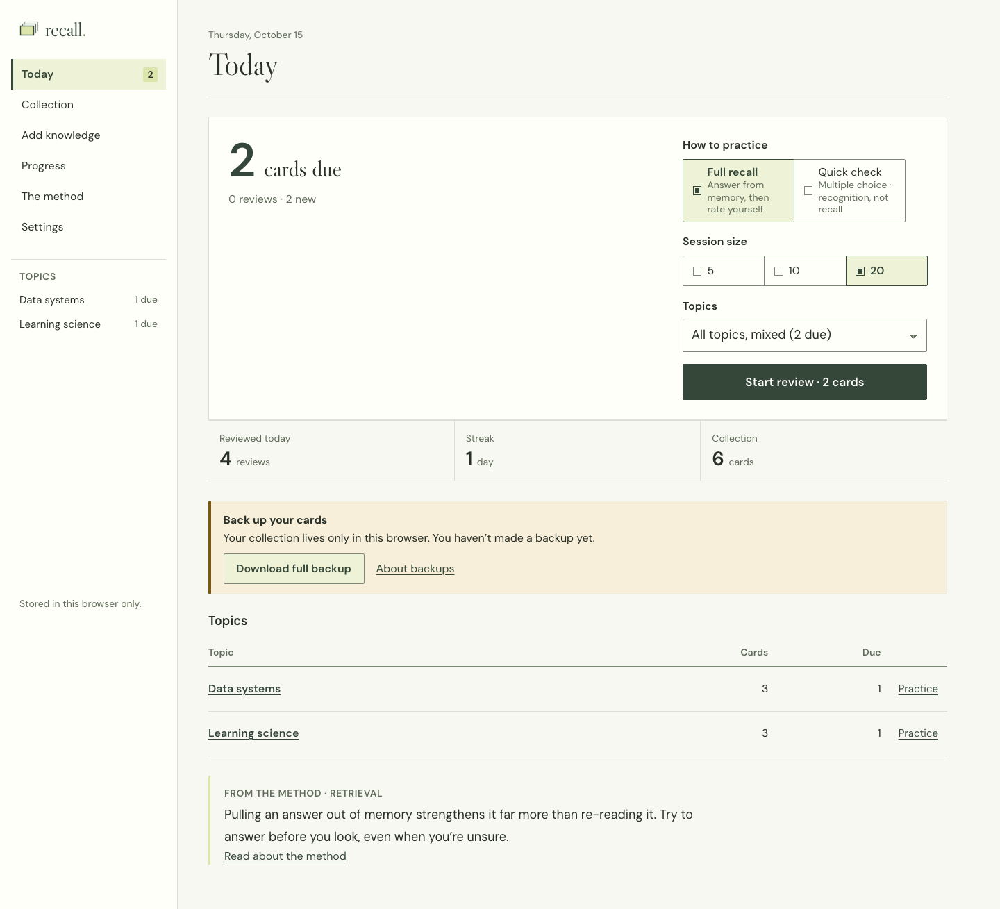
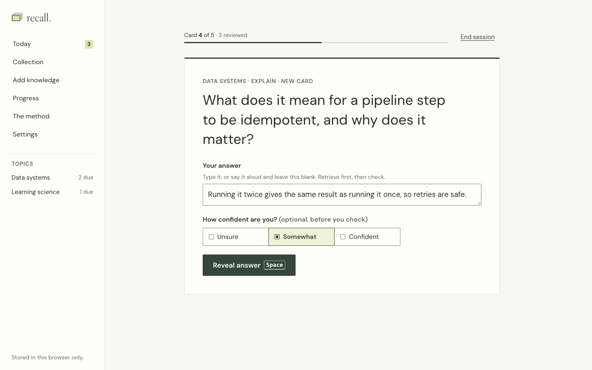
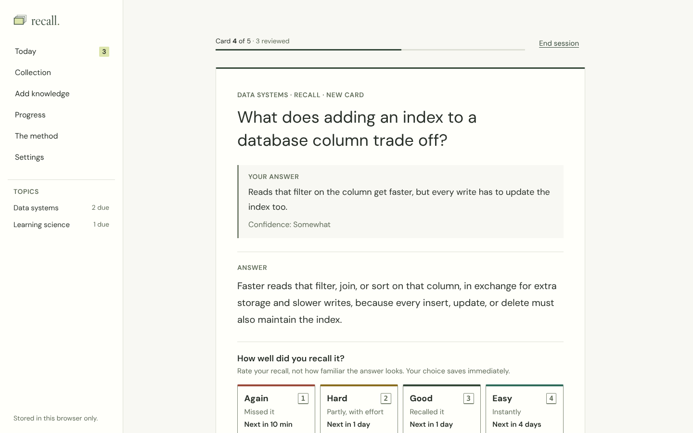

# recall.

A personal learning workspace for turning concepts and notes into durable knowledge through active recall, spaced
repetition, interleaving, and reflection. It's a quiet study studio rather than a dashboard: one good question, an
honest attempt from memory, a check, and a well-timed return.

This is the standalone rebuild of the original Recall app described in [`docs/PRD.md`](docs/PRD.md). It runs entirely
in the browser, with no account, server, or AI service.

| Today                                        | Practice                                           | Answer                                         |
| -------------------------------------------- | -------------------------------------------------- | ---------------------------------------------- |
|  |  |  |

More screenshots, at desktop and phone widths, are in [`docs/screenshots/`](docs/screenshots/).

## What it does

- **Today:** what's due, a session size (5/10/20) and topic choice, streak and activity, and a starter collection when
  the app is empty.
- **Practice:** the question comes first. Type an answer or say it aloud, optionally record your confidence, reveal the
  answer, and rate it Again, Hard, Good, or Easy. Each rating button shows when the card will come back. Space reveals
  and 1–4 rate, but only when you aren't typing.
- **Collection:** search, filter by topic and status, edit cards, inspect a card's schedule and history, pause or
  resume, reset progress, or delete.
- **Add knowledge:** write cards (Markdown, including code blocks), or copy a ready-made prompt into any AI assistant
  and paste its JSON back in. Every import is validated and previewed before anything is saved.
- **Progress:** 14-day activity, self-ratings (labelled as self-reported), cards with long intervals, a confidence vs.
  self-rating comparison, and your saved reflections.
- **Settings:** reading size, default session size, timezone, full backups and restore, content export, and deleting
  all data.

AI grading and in-app card generation are not part of this version (they're P1 in the PRD and need an approved
inference provider). See [Roadmap](#roadmap).

## Run it locally

Requires Node.js 20.19+ or 22.12+.

```bash
npm install
npm run dev          # http://localhost:5173
```

Other scripts:

| Command            | What it does                                                         |
| ------------------ | -------------------------------------------------------------------- |
| `npm run build`    | Type-check and build static files into `dist/`                       |
| `npm run preview`  | Serve the production build at http://localhost:4173                  |
| `npm test`         | Unit tests (Vitest, with an in-memory IndexedDB)                     |
| `npm run test:e2e` | End-to-end, accessibility, and reflow tests in Chromium (Playwright) |
| `npm run check`    | Type-check, formatting check, unit tests, and build: what CI runs    |
| `npm run format`   | Format with Prettier                                                 |

The first time you run end-to-end tests on a new machine, install the browser: `npx playwright install chromium`.

## Where your data lives

Everything is stored in your browser's IndexedDB on the device you're using. Nothing is sent anywhere.

- **Each browser has its own collection.** Opening Recall on your phone and your laptop gives you two separate
  collections. To move data between them, download a full backup on one and restore it on the other (Settings →
  Your data and backups). There is no sync yet.
- **Browser data can be cleared.** Clearing site data, private browsing, or storage pressure can remove it. Recall asks
  the browser for persistent storage once you've added cards, and Settings shows whether it was granted.
- **iPhone and iPad:** Safari may delete site data for sites you haven't visited in a while. Add Recall to your Home
  Screen (Share → Add to Home Screen) to avoid that, and keep backups.
- Today shows a reminder when you have cards and haven't made a backup in 14 days.

### Backups and recovery

| Export                               | Contains                                                             | Use it to                                                             |
| ------------------------------------ | -------------------------------------------------------------------- | --------------------------------------------------------------------- |
| **Full backup** (`recall-backup` v1) | Cards, schedules, review history, sessions, reflections, preferences | Restore, or move to another browser or device                         |
| **Cards only** (`recall-v1`)         | Topic, question, answer, kind, source                                | Share cards or feed them to another tool; imported cards start as new |

To recover, open Settings → Restore from a full backup and choose the file. Recall validates it first and shows what it
contains next to what's currently in the browser. Restoring replaces the workspace in a single transaction, so it either
completes fully or changes nothing. Backups up to 50 MB are supported.

### Moving cards over from the original Recall

Export your cards from the original app (its content export uses `recall-v1`), then use Add knowledge → Import cards
and paste or choose the file. Content, Unicode, code, and multi-line answers are kept exactly. Content-only exports don't
contain review history, so the imported cards start as new. Imports are reviewed in batches of up to 100 cards.

## Using it: GitHub Pages and offline

Every push to `main` builds, tests, and publishes the app to **https://stefanjenss.github.io/recall/** through
`.github/workflows/deploy.yml`. Nothing is published unless type-checking, formatting, unit tests, and the build all pass.

**One-time setup:** in the repository's **Settings → Pages → Build and deployment**, set **Source** to **GitHub Actions**.
If a deploy ran before that was set, re-run it from the Actions tab.

**Offline:** after you've opened Recall once, it loads and works without a connection, so you can study on a plane or
the subway. A service worker (`src/offline/sw.js`) caches the app's files. Your cards were always stored on the device,
so study, reviews, and backups all work offline. When a new version is published, Recall downloads it in the
background and shows **"A new version of Recall is ready"**; it switches only when you choose **Reload now**, never in
the middle of a session. Settings → Your data and backups shows whether offline use is ready.

**Install it like an app:** on iPhone or iPad, open the site in Safari and choose Share → Add to Home Screen. On
Android or desktop Chrome, use Install app from the browser menu. A Home Screen install also stops Safari from clearing
Recall's data after weeks without a visit.

**Each web address keeps its own data.** The GitHub Pages URL, `localhost` during development, and any future address
(such as a home server) are separate collections. To move, download a full backup at the old address and restore it
at the new one. Also note that every GitHub Pages site under `stefanjenss.github.io` shares one browser origin, so only
publish code you trust there; a custom domain would give Recall its own.

**Other hosts:** `npm run build` produces a static site in `dist/` with relative asset paths and hash-based routing, so
any static file server works without rewrite rules. Offline support needs HTTPS (or `localhost`).

## Project layout

```
src/
  domain/     Pure logic: types, scheduler (recall-sm2-v1), queue building, limits, time, stats
  content/    Import parsing/validation, content export, full backup format, starter cards, assistant prompt
  storage/    IndexedDB schema (db.ts) and the repository: the only code that reads or writes storage
  app/        App shell, hash router, workspace context, flash messages
  offline/    Service worker template and registration (offline use, update prompt)
  ui/         Screens, shared components, Markdown rendering, styles
tests/
  unit/       Scheduler, queue, time/DST, import, Markdown safety, repository (transactions, backups)
  e2e/        Study loop, keyboard rules, refresh recovery, two tabs, import, backup/restore, a11y, reflow, offline
scripts/      Screenshot capture, a 5,000-card performance check, icon rendering
docs/         PRD, decisions, data/backup schema, acceptance checklist, screenshots
```

More detail: [`docs/DECISIONS.md`](docs/DECISIONS.md) (technical choices),
[`docs/DATA.md`](docs/DATA.md) (storage, backup, and import formats), and
[`docs/ACCEPTANCE.md`](docs/ACCEPTANCE.md) (what has been verified, and how).

## Roadmap

From the PRD, in priority order. None of these are built yet.

- **P1 — AI grading and generation.** Rubrics, a provider-neutral evaluator interface, and structured feedback on
  what's right, missing, or wrong. Grading needs a verified inference route and your sign-off on its cost and access. A
  hosted provider would need a small backend or proxy, because API keys can't live in a static site.
- **P2 — Sync, FSRS, and more.** Account-backed sync across devices, an FSRS scheduler (versioned, with a migration),
  burying related cards, reminders, and agent/MCP card saving.
